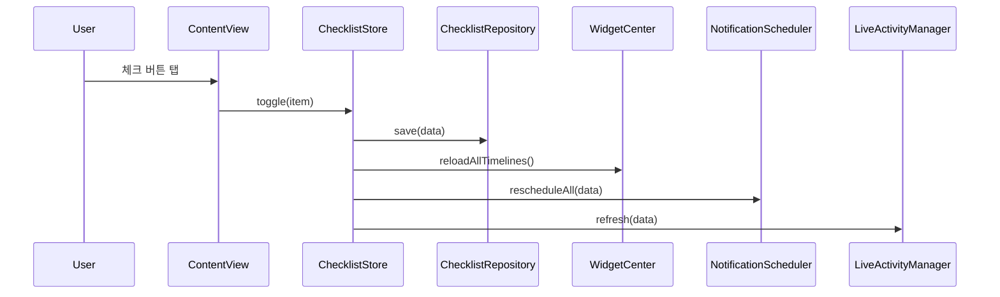
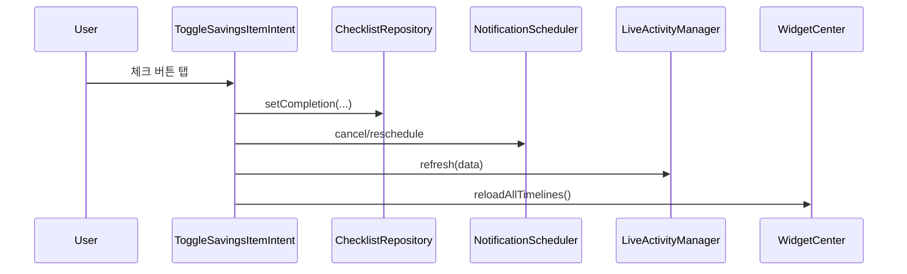

# 아키텍처 개요

## 1. 설계 요약

DonCheck는 iOS 앱 타깃과 WidgetKit extension 타깃으로 구성된다. 두 타깃은 별도 프로세스로 실행되며 `Shared/` 아래의 모델, 저장소, 알림 및 ActivityKit 코드를 함께 컴파일한다.

중앙 서버가 없기 때문에 App Group 저장소가 프로세스 간 단일 진실 공급원이다. UI 상태 객체는 저장소의 복사본을 보유하지만, 위젯 intent나 notification action처럼 앱 바깥에서 변경이 발생할 수 있으므로 앱이 활성화될 때 다시 로드한다.

## 2. 타깃 구성

### 2.1 DonCheck 앱 타깃

책임:

- 항목 생성, 수정, 삭제 UI
- 현재 월급 주기 요약과 목록 표시
- 알림 권한 상태 및 설정 화면
- notification action delegate 처리
- 저장 이후 파생 시스템 상태 재구성

주요 파일:

- `DonCheckApp.swift`: 앱 진입점, `AppDelegate`, 알림 category 등록
- `ChecklistStore.swift`: UI state와 use case orchestration
- `ContentView.swift`: 메인 화면
- `ItemEditorView.swift`: 편집 화면
- `SettingsView.swift`: 알림 및 Live Activity 제어

### 2.2 DonCheckWidget extension 타깃

책임:

- Home Screen/Lock Screen widget 제공
- Live Activity의 Lock Screen/Dynamic Island UI 제공
- App Intent 버튼을 통해 완료 상태 변경

주요 파일:

- `DonCheckWidgetBundle.swift`: 일반 위젯과 Live Activity 등록
- `DonCheckWidget.swift`: timeline provider 및 widget family별 화면
- `SavingsChecklistLiveActivity.swift`: ActivityKit presentation
- `Info.plist`: WidgetKit extension point 선언

### 2.3 Shared 코드

`Shared/`는 별도 framework가 아니라 두 타깃의 Compile Sources에 직접 포함된다.

| 파일 | 책임 |
|---|---|
| `AppConfig.swift` | App Group ID와 notification ID prefix |
| `Models.swift` | 도메인 모델, 월급 주기 키, 날짜 계산 |
| `ChecklistRepository.swift` | JSON load/save와 완료 변경 |
| `NotificationScheduler.swift` | 로컬 알림 생성, 제거, badge |
| `SavingsChecklistActivity.swift` | Activity attributes/state와 lifecycle |
| `ToggleSavingsItemIntent.swift` | 위젯/Live Activity 완료 액션 |

## 3. 런타임 데이터 흐름

### 3.1 앱에서 체크

### 3.2 위젯 또는 Live Activity에서 체크

`ToggleSavingsItemIntent`는 `LiveActivityIntent`를 채택한다. 같은 타입을 일반 위젯 버튼에서도 재사용하며 앱 타깃과 extension 타깃 양쪽에 포함한다.

### 3.3 알림 액션에서 체크

`AppDelegate.userNotificationCenter(_:didReceive:)`가 입금 또는 저축 완료 액션을 받는다. action ID와 notification `userInfo`에 들어 있는 `itemID`, `cycleKey`로 단계별 완료 기록을 저장한 뒤 알림과 Live Activity를 다시 구성한다.

앱 화면이 실행 중인 경우 `.checklistDidChange` notification을 통해 `ChecklistStore.reload()`를 호출한다.

## 4. 일관성 모델

현재 저장소는 transaction database가 아니다. 작은 개인용 데이터 규모와 낮은 동시 변경 빈도를 전제로 read-modify-write 방식으로 동작한다.

일관성 규칙:

1. 공유 저장소가 canonical state다.
2. 파생 값인 pending notification, badge, widget timeline, Live Activity는 언제든 재생성할 수 있다.
3. 항목 체크는 동일 `(itemID, cycleKey, step)` 완료 기록을 먼저 제거한 뒤 필요하면 한 건만 추가한다.
4. 앱 UI는 foreground 진입 시 저장소를 reload한다.
5. 위젯은 timeline 생성 시 저장소를 직접 load한다.

### 동시성 주의점

`ChecklistRepository`는 명시적 lock이나 actor로 보호되지 않는다. 앱과 extension이 거의 동시에 서로 다른 항목을 변경하면 마지막 write가 앞선 write를 덮을 가능성이 있다. 개인용 저빈도 상호작용에서는 수용했지만, 다중 프로세스 동시성을 강화하려면 다음 중 하나가 필요하다.

- file coordination을 포함한 atomic file store
- App Group SQLite/Core Data/SwiftData store
- 변경 단위 append log
- 별도 synchronization actor와 프로세스 간 coordination

## 5. 파생 상태 재구성

`ChecklistStore.persist()`는 다음 순서로 동작한다.

1. 24개월 이전 완료 기록 제거
2. repository save
3. widget timeline reload 요청
4. 비동기 notification 전체 재예약
5. 비동기 Live Activity refresh

이 방식은 구현이 단순하고 수정/삭제/체크의 모든 경우를 같은 코드 경로로 처리한다. 반면 항목 하나를 바꿀 때도 모든 알림을 재계산한다. 현재 데이터 규모에서는 의도된 trade-off다.

## 6. OS 버전 분기

| 기능 | iOS 17~25 | iOS 26 이상 |
|---|---:|---:|
| SwiftUI 앱 | 지원 | 지원 |
| Interactive widget | 지원 | 지원 |
| 즉시 Live Activity 시작 | 지원 | 지원 |
| 미래 Live Activity 로컬 예약 | 미지원 | 지원 |
| Live Activity 릴레이 사전 예약 | 미지원 | 지원 |
| 로컬 알림 | 지원 | 지원 |

ActivityKit 예약 API는 `#available(iOS 26.0, *)` 안에서만 호출한다. 낮은 버전에서는 로컬 알림이 자동 진입점 역할을 하며 사용자가 앱 설정에서 Live Activity를 수동으로 시작할 수 있다.

## 7. 오류 격리

- Live Activity 자동 갱신 실패는 로컬 알림 흐름을 중단하지 않는다.
- 수동 Live Activity 시작 실패는 `liveActivityMessage`를 통해 사용자에게 표시한다.
- notification 등록 실패는 현재 `try?`로 무시한다. 운영 수준 진단이 필요하면 structured logging을 추가해야 한다.
- repository decode 실패는 빈 데이터로 fallback한다. 손상 데이터 복구/백업은 현재 제공하지 않는다.

## 8. 확장 지점

- 저장소 protocol 추출 후 SwiftData 또는 SQLite로 교체
- `Clock`/`Calendar` 주입을 통한 날짜 계산 unit test
- notification scheduler protocol로 테스트 대역 제공
- APNs 서버를 추가해 Live Activity 릴레이를 원격 연장
- iCloud/CloudKit 동기화
- 월별 history 화면과 export
