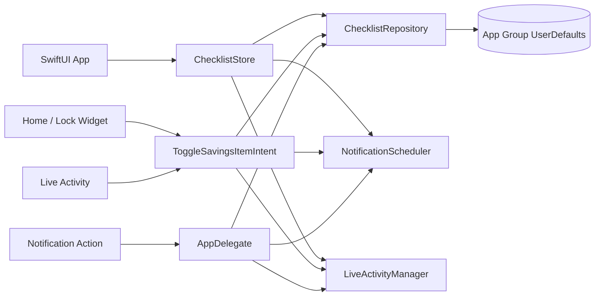

# 돈 체크 (DonCheck)

매달 자동이체 전에 필요한 금액을 계좌에 준비했는지 확인하는 개인용 iPhone 체크리스트입니다. 일반 할 일 앱과 달리 출금 준비라는 한 가지 작업에 집중하며, 앱·홈 화면 위젯·잠금 화면·Dynamic Island·로컬 알림에서 같은 완료 상태를 공유합니다.

이 저장소는 서버 없이 동작하는 local-first MVP입니다. 체크리스트와 완료 기록은 App Group의 `UserDefaults`에 JSON으로 저장되고 외부로 전송되지 않습니다.

## 핵심 기능

- 항목별 이름, 금액, 매월 출금일, 알림 시각 설정
- 항목별 사전 알림일 및 미완료 재알림 횟수 설정
- 월급일 기준으로 완료 기록을 분리하여 새 주기 자동 초기화
- 매월 1~31일 중 월급일 설정, 짧은 달은 말일 자동 보정
- 항목별 `입금 완료`와 선택적 `저축 완료` 2단계 체크
- 앱, 홈 화면 위젯, 잠금 화면 위젯에서 완료 상태 공유
- 알림의 `입금 완료`/`저축 완료` 액션으로 앱을 열지 않고 단계별 완료 처리
- 잠금 화면과 Dynamic Island에 표시되는 interactive Live Activity
- iOS 26 이상에서 Live Activity 예약 시작 및 릴레이 유지
- 미완료 항목 수를 앱 아이콘 배지로 표시
- 서버·계정·분석 SDK 없이 기기 내부에서만 동작

## 지원 범위

| 항목 | 지원 범위 |
|---|---|
| 최소 배포 버전 | iOS 17.0 |
| 권장 실행 버전 | iOS 26 이상 |
| UI | SwiftUI |
| 위젯 | WidgetKit |
| 위젯 상호작용 | App Intents |
| Live Activity | ActivityKit |
| 알림 | UserNotifications |
| 영속 저장소 | App Group `UserDefaults` + `Codable` JSON |
| 서버 | 없음 |

iOS 17~25에서도 앱, 위젯, 로컬 알림 및 수동 Live Activity 시작을 사용할 수 있습니다. 특정 날짜에 Live Activity를 로컬 예약하는 API는 iOS 26 이상에서만 사용합니다.

## 사용자 흐름

1. 앱에서 저축 항목을 추가합니다.
2. 이름, 금액, 매월 출금일, 알림 시각을 설정합니다.
3. 필요하면 사전 알림과 출금일 이후 재알림 횟수를 조정합니다.
4. 자동이체 후 확인이 필요한 항목은 `저축 완료` 단계를 켭니다.
5. 알림, 앱, 위젯 또는 Live Activity에서 입금 완료와 저축 완료를 체크합니다.
6. 설정에서 월급일을 선택합니다. 기본값은 매월 1일입니다.
7. 완료 상태는 현재 월급 주기와 단계별 기록으로 저장됩니다.
8. 다음 월급일이 되면 동일 항목이 새 주기의 미완료 상태로 자동 표시됩니다.

물리적으로 체크 값을 초기화하거나 기존 기록을 삭제하지 않습니다. 완료 여부는 `(itemID, cycleKey, step)` 조합으로 판단하기 때문에 월급일에 새 체크리스트가 자연스럽게 만들어지고 과거 기록도 남습니다.

## 시스템 구성



모든 입력 경로는 먼저 공유 저장소를 갱신한 뒤 알림, 위젯 타임라인, Live Activity를 다시 동기화합니다. 위젯과 앱이 서로 다른 프로세스에서 실행되므로 저장소를 단일 진실 공급원으로 사용합니다.

## 프로젝트 구조

```text
.
├── DonCheck.xcodeproj/                 # Xcode 프로젝트
├── DonCheck/                           # iOS 앱 타깃
│   ├── DonCheckApp.swift               # 앱 진입점과 알림 액션 처리
│   ├── ChecklistStore.swift            # 화면 상태 및 기능 오케스트레이션
│   ├── ContentView.swift               # 월급 주기 대시보드와 항목 목록
│   ├── ItemEditorView.swift            # 항목 생성·수정 폼
│   ├── SettingsView.swift              # 권한, 재예약, Live Activity 시작
│   └── DonCheck.entitlements           # App Group entitlement
├── DonCheckWidget/                     # WidgetKit extension 타깃
│   ├── DonCheckWidget.swift             # 홈·잠금 화면 위젯
│   ├── SavingsChecklistLiveActivity.swift
│   ├── DonCheckWidgetBundle.swift
│   ├── DonCheckWidget.entitlements
│   └── Info.plist
├── Shared/                             # 앱과 extension이 함께 컴파일하는 코드
│   ├── AppConfig.swift
│   ├── Models.swift
│   ├── ChecklistRepository.swift
│   ├── NotificationScheduler.swift
│   ├── SavingsChecklistActivity.swift
│   └── ToggleSavingsItemIntent.swift
└── Docs/                               # 기능별 상세 개발 문서
```

## 빠른 시작

### 요구 사항

- Xcode 26.6 이상 권장
- iOS 17 이상 시뮬레이터 또는 실제 iPhone
- 실제 기기 설치 시 Apple ID와 Signing Team
- 앱과 위젯의 데이터 공유를 위한 App Group capability

### Xcode에서 실행

1. [DonCheck.xcodeproj](DonCheck.xcodeproj)을 엽니다.
2. `DonCheck` 타깃의 Signing Team을 선택합니다.
3. `DonCheckWidget` 타깃에도 동일한 Signing Team을 선택합니다.
4. 실제 기기 또는 시뮬레이터를 선택합니다.
5. `DonCheck` scheme을 Run합니다.
6. 첫 실행 후 앱 설정에서 알림을 허용합니다.
7. 홈 화면이나 잠금 화면에 `저축 체크리스트` 위젯을 추가합니다.

### 식별자 변경

현재 프로젝트의 기본 식별자는 다음과 같습니다.

```text
App Bundle ID:        com.heeyeon.DonCheck
Widget Bundle ID:     com.heeyeon.DonCheck.Widget
App Group ID:         group.com.heeyeon.DonCheck
```

다른 계정에서 이 식별자를 사용할 수 없다면 세 값을 모두 본인 고유 값으로 변경해야 합니다. App Group ID는 다음 위치가 반드시 동일해야 합니다.

- `Shared/AppConfig.swift`
- `DonCheck/DonCheck.entitlements`
- `DonCheckWidget/DonCheckWidget.entitlements`
- Apple Developer portal 또는 Xcode Signing & Capabilities

App Group이 불일치하면 앱 자체 저장은 동작할 수 있지만 위젯과 앱의 데이터가 공유되지 않습니다.

## 명령행 빌드

```bash
DEVELOPER_DIR=/Applications/Xcode.app/Contents/Developer \
xcodebuild \
  -project DonCheck.xcodeproj \
  -scheme DonCheck \
  -sdk iphonesimulator \
  -configuration Debug \
  CODE_SIGNING_ALLOWED=NO \
  build
```

특정 시뮬레이터를 사용하려면 다음 형식을 사용합니다.

```bash
DEVELOPER_DIR=/Applications/Xcode.app/Contents/Developer \
xcodebuild \
  -project DonCheck.xcodeproj \
  -scheme DonCheck \
  -destination 'platform=iOS Simulator,name=iPhone 17 Pro' \
  -configuration Debug \
  CODE_SIGNING_ALLOWED=NO \
  build
```

Debug 빌드에서는 scheme의 launch argument에 `-startLiveChecklist`를 추가하면 앱 시작 직후 Live Activity 시작 경로를 시험할 수 있습니다. 미완료 항목이 최소 한 개 있어야 합니다.

## 월급일 기준 주기 규칙

- 설정에서 월급일을 1~31일 중 선택하며 기본값은 1일입니다.
- 주기 키는 시작일을 나타내는 `yyyy-MM-dd` 형식입니다. 예: `2026-11-25`.
- 월급일 당일 00:00부터 새 주기가 시작됩니다.
- 완료 기록은 항목 ID, 주기 키, 완료 단계의 조합으로 저장됩니다.
- 비자동이체 항목은 입금 완료만으로 끝나고, 자동이체 확인 항목은 입금과 저축 완료가 모두 필요합니다.
- 월급일이 29~31일이고 해당 월에 그 날짜가 없으면 그 달의 마지막 날을 사용합니다.
- 출금일이 29~31일이고 해당 월에 그 날짜가 없으면 그 달의 마지막 날로 보정합니다.
- 금액은 정수 원 단위로 저장합니다.
- 완료 기록은 데이터를 저장할 때 최근 24개월만 유지합니다.
- 새 주기가 시작되어도 항목 정의와 과거 기록은 유지되고 완료 상태만 새 주기 기준으로 계산됩니다.

## 알림 동작

각 항목은 최대 다음 알림을 만듭니다.

1. `leadDays`가 1 이상이면 출금일 N일 전 입금 사전 알림
2. 출금일의 입금 확인 알림
3. 자동이체 확인 항목은 출금일의 저축 완료 확인 알림
4. 각 단계가 미완료라면 출금일 이후 최대 `followUpCount`일 동안 단계별 재알림

사전 알림은 일반 active interruption level을 사용하고, 출금일 및 재알림은 time-sensitive level을 사용합니다. 사용자는 시스템 설정에서 time-sensitive 권한을 끌 수 있습니다.

앱은 자신이 만든 기존 pending request를 지운 뒤 현재 월급 주기와 다음 주기의 출금 건을 다시 계산합니다. iOS의 pending notification 제한을 고려해 가장 가까운 60개만 등록합니다.

## Live Activity 유지 전략

일반 알림은 다른 알림에 의해 아래로 밀릴 수 있으므로, 중요한 기간에는 같은 체크리스트를 Live Activity로 표시합니다.

- 잠금 화면과 Dynamic Island에 미완료 개수 및 금액 표시
- 잠금 화면에서 최대 4개 항목 표시
- Dynamic Island 확장 화면에서 최대 3개 미완료 항목 표시
- 입금/저축 체크 버튼은 `LiveActivityIntent`를 통해 공유 저장소를 갱신
- 모든 항목이 완료되면 active/pending Live Activity 종료
- iOS 26 이상에서는 최초 주의 시점에 시작하도록 예약
- 7시간 55분 간격으로 후속 활동을 예약
- 시스템 한도 5개 중 1개는 active용으로 남기고 후속 pending은 최대 4개 생성
- active 1개와 후속 4개를 합쳐 약 40시간 범위를 확보

Live Activity의 표시 우선순위와 Dynamic Island 점유는 iOS가 결정합니다. 다른 앱보다 항상 우선하도록 강제할 수 없고, 사용자가 직접 제거할 수도 있습니다. 서버 없이 무기한 연장하는 것도 보장할 수 없습니다.

## 개인정보와 네트워크

- 사용자 계정 없음
- 서버 저장 없음
- APNs 서버 없음
- 분석·광고 SDK 없음
- 금융기관 연동 없음
- 계좌번호나 거래 내역 자동 수집 없음

현재 데이터는 iCloud에 동기화되지 않습니다. 앱 삭제 시 App Group 컨테이너의 데이터도 삭제될 수 있으므로 중요한 기록의 영구 보관 용도로 사용하면 안 됩니다.

## 알려진 제한 사항

- Dynamic Island에서 다른 앱보다 항상 우선할 수 없습니다.
- Live Activity 한 개는 시스템 정책상 활성 시간이 제한됩니다.
- 로컬 릴레이 예약 개수도 시스템 한도를 받습니다.
- iOS 17~25에서는 특정 미래 시각에 Live Activity를 로컬 예약할 수 없습니다.
- 위젯 및 Live Activity payload는 크기 제한을 받으므로 항목 수가 매우 많으면 별도 축약 전략이 필요합니다.
- 현재 자동화된 unit/UI test target은 없습니다.
- 현재 저장 스키마 키는 `checklist-data-v3`이며 v1/v2 데이터는 최초 load 때 자동 변환됩니다.
- Apple 미리 알림 앱과는 동기화하지 않습니다.

## 상세 문서

| 문서 | 내용 |
|---|---|
| [문서 인덱스](Docs/README.md) | 전체 문서 탐색 |
| [제품 요구사항](Docs/product/requirements.md) | 목표, 비목표, 사용자 시나리오 |
| [제품 로드맵](Docs/product/roadmap.md) | 월급일 초기화와 항목별 2단계 체크 등 구현 예정 기능 |
| [아키텍처](Docs/architecture/overview.md) | 타깃, 프로세스, 데이터 흐름 |
| [체크리스트와 월급 주기](Docs/features/checklist.md) | 모델과 완료 상태 계산 |
| [앱 UI와 상태 관리](Docs/features/app-ui.md) | 화면 구조, 입력 검증, lifecycle |
| [알림](Docs/features/notifications.md) | 예약, 액션, 취소, 제한 |
| [Live Activity](Docs/features/live-activity.md) | UI, 릴레이, OS별 동작, 실패 처리 |
| [위젯](Docs/features/widgets.md) | family별 UI와 timeline |
| [저장소](Docs/data/storage.md) | App Group, JSON schema, 보존 정책 |
| [빌드와 서명](Docs/development/build-and-signing.md) | Xcode 설정과 실제 기기 설치 |
| [테스트](Docs/development/testing.md) | 수동 검증표와 명령 |
| [문제 해결](Docs/operations/troubleshooting.md) | Live Activity, 위젯, 알림 진단 |

## 개발 상태

현재 앱과 위젯 extension은 iOS Simulator Debug configuration에서 전체 빌드를 통과합니다. 기능을 변경한 뒤에는 앱 타깃뿐 아니라 extension embedding과 App Intents metadata 추출까지 포함하는 `DonCheck` scheme 전체 빌드를 실행해야 합니다.
